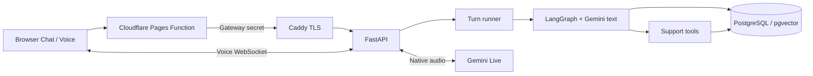

# Loopp Customer Support Agent

A full-stack, fictional customer-support agent for the Loopp assessment: streaming text chat, real-time voice, multi-step tool orchestration, policy retrieval with confidence guardrails, shared conversation memory, and production-minded observability and failure handling.

Mock refunds never move money. Demo email lookup is identity resolution for the demo, not authentication.

## Live application and demonstration

| Resource | Link |
| --- | --- |
| Live app | [https://loopp-support.pages.dev](https://loopp-support.pages.dev) |
| Source repository | [https://github.com/saitejareddi3636/loop-support](https://github.com/saitejareddi3636/loop-support) |
| Loom walkthrough | [https://www.loom.com/share/3e7bbabe038f47fcb52c6df0911aa6bd](https://www.loom.com/share/3e7bbabe038f47fcb52c6df0911aa6bd) |

## Demo accounts and example workflows

Seeded fictional accounts (email pattern `firstname.lastname@example.test`):

| Email | Tier | Status | Useful for |
| --- | --- | --- | --- |
| `sam.patel@example.test` | Business | active | Eligible monthly invoices, policy Q&A, mock refund confirmation |
| `alex.morgan@example.test` | Pro | active | Multi-invoice choice, ownership boundaries |
| `jordan.lee@example.test` | Free | active | Billing discrepancy / tier mismatch without unsolicited refunds |
| `taylor.chen@example.test` | Enterprise | active | Human-review refund path, ticket consent |
| `avery.reed@example.test` | Free | suspended | Account restrictions stated without inventing causes |

**Suggested workflows**

1. Text: identify as Sam → list recent charges → ask a Business refund-window policy question → prepare a mock refund for one owned invoice → confirm only via **Confirm invoice and amount**.
2. Text: as Alex, ask about Sam’s invoice ID → expect an ownership refusal with no cross-customer facts.
3. Text: as Jordan, ask why the account still looks Free after a Starter charge → expect account/invoice facts, not an automatic refund offer.
4. Voice: open Voice, allow the microphone, ask an account or policy question, interrupt while the agent speaks, then continue in the same conversation from Chat.

## Core capabilities

Aligned with the assessment requirements:

- **Full-stack agent** — React UI, FastAPI API, PostgreSQL, Cloudflare Pages + Oracle deployment path.
- **Streaming text chat** — Server-sent events with progressive deltas after grounded composition.
- **Real-time voice** — Gemini Live native audio over WebSocket; waveform orb, transcripts, barge-in / interruption handling in the browser bridge.
- **Autonomous multi-step tools** — LangGraph selects among verify, account, invoice, list, policy search, mock refund staging, and escalation ticket creation by intent.
- **Vector retrieval** — pgvector over section-aware policy chunks with version/tier/date filters.
- **Confidence guardrails** — Similarity threshold, citation revalidation, optional relevance verifier, fail-closed escalation offers (no ticket without consent).
- **Shared memory** — One `chat_id` and PostgreSQL-backed messages, context, receipts, and tickets across Chat and Voice, with hydrate-on-switch so history survives mode changes and disconnects.
- **Observability** — Prompt traces, tool timing, latency, text token usage, and text-only cost estimates in the Activity panel and persisted traces.
- **Failure handling** — Retries with budgets for transient provider errors, rate limits, voice socket caps, and deterministic financial safeguards independent of model wording.

## System architecture



React/TypeScript renders Chat and Voice. FastAPI streams text over SSE and bridges Gemini Live audio. Both modes share persisted conversations and the same tool surface. Secrets stay in server/Pages configuration, not the browser bundle.

## Agent orchestration and conversation memory

The system prompt frames a **general** support assistant, not a refund-only bot. Capabilities are separate: identity, account status, invoice facts, invoice inventory, policy retrieval, refund staging, and tickets. The model chooses tools from conversation context; the backend still owns authorization.

**Backend-deterministic controls**

- Customer verification and invoice ownership
- Refund eligibility, staging TTL, confirmation token, and idempotent issuance
- Ticket creation only after clear customer authorization
- Fact checks that strip unsupported amounts, IDs, and unsolicited refund offers

**Conversation memory** includes verified account fields, selected invoice references, open tickets, and persisted mock receipts. After identity verification, the agent continues the customer’s earlier unresolved concern instead of resetting. Abandoned refund intents and topic changes are handled by intent-led tool choice plus compose rules that avoid volunteering refund cards.

Chat↔Voice synchronization: in-flight text turns finish outside the HTTP cancel scope, and both UIs restore the shared chat from Postgres on mount so messages, receipts, and tool traces remain consistent after unmount or WebSocket disconnect.

## RAG, chunking, retrieval, and confidence guardrails

Policy documents are split with section-aware chunking (roughly 180–300 estimated tokens, sentence overlap). Unchanged chunks reuse content-hashed 768-dimensional embeddings. Retrieval keeps active versions, filters by date and tier, ranks a small top-k, and revalidates citations against stored source text.

With `RELEVANCE_VERIFIER=on` (default), a bounded relevance model must accept the passage before it grounds an answer. Timeouts, rate limits, and malformed verdicts fail closed and offer escalation without creating a ticket.

**Retrieval guardrail measurements** (embedding + verifier calls; “correct” = accept in-scope or reject out-of-scope, not answer quality):

| Set | Group | Retrieval-only | Verified |
| --- | --- | ---: | ---: |
| Original 20 | In scope (10) | 10/10 | 10/10 |
| Original 20 | Out of scope (10) | 9/10 | 10/10 |
| Frozen 30 | In-scope paraphrases (15) | 15/15 | 13/15 |
| Frozen 30 | Challenging out-of-scope (15) | 0/15 | 15/15 |

Similarity alone cannot separate the frozen sets (out-of-scope max **0.789** vs in-scope min **0.690** at threshold **0.68**). Two known false rejections remain on the frozen in-scope paraphrases. Held-out frozen queries were not used to tune the verifier.

## Real-time voice and streaming

Voice uses Gemini Live over a server WebSocket. The client captures microphone audio, renders an analyser-driven waveform, shows transcripts, and supports interruption while the agent speaks. Each spoken turn is executed through the same `run_turn` pipeline as text (`support_request`), so tools, memory, and safeguards stay consistent.

Text chat streams SSE events (model progress, tools, composed answer deltas). Final customer-visible wording is composed after tool results and grounding so financial and ticket language stays backend-safe.

**Automated vs manual voice**

| Check | Coverage |
| --- | --- |
| Backend WebSocket / session limits | Automated in the regression suite |
| Shared chat↔voice `chat_id`, hydrate-on-switch, and tool path | Automated regression + live LLM scenarios |
| Microphone, speaker playback, mute, spoken barge-in | Manual browser validation; demonstrated in the [Loom walkthrough](https://www.loom.com/share/3e7bbabe038f47fcb52c6df0911aa6bd) |

## Observability and failure handling

- Prompt and tool traces persisted per turn; Activity UI shows tools, latency, tokens, and text-only cost estimates.
- Sessions: creation quotas per peer/global; agent rate limits return 429.
- Provider 429/timeouts: up to three attempts inside a 45s budget; state-changing tools are not blindly replayed.
- Voice: per-session and global socket caps; idle/hidden-tab release.
- Refunds and tickets remain enforceable even if the model hallucinates wording.

Displayed cost is a **text-only estimate**. Live audio and embedding costs are unavailable from the provider path used here and are not fabricated into a session total.

## Engineering challenges, decisions, and trade-offs

| Challenge | Approach | Trade-off |
| --- | --- | --- |
| Context retention after verify | Inject verified account/receipts/tickets into model context; continue prior concern after identity | Slightly larger prompts; fewer redundant `get_account` calls |
| Chat↔Voice history drift on mode switch | Persist turns beyond request cancel; hydrate shared chat from Postgres on Chat/Voice mount | Extra restore round-trip; avoids silent history loss |
| Refund-assistant drift | Intent-separated tools, strip unsolicited refund offers in compose, UI refund cards only when choice is required | Occasional model attempts still occur; backend/UI block bad outcomes |
| Wrong tool / failed policy wiping facts | Compose keeps invoice/account summaries when policy retrieval is not GROUNDED | May answer with structured facts plus an honest “policy not verified” note |
| Retrieval relevance overlap | Threshold + citation checks + relevance verifier | Extra model call; two known in-scope false rejects on the frozen set |
| Safe transactions | Eligibility, ownership, button confirmation, idempotency in PostgreSQL; spoken yes cannot issue | Demo cannot show “say yes to refund” UX by design |
| Ticket honesty | Demo tickets record requests; copy does not promise a live team follow-up | Less “support theater,” clearer demo boundaries |

## Local setup

Requires Python 3.11+, Node 20+, Docker Compose, and a Gemini API key.

```sh
cp .env.example .env
python3 -m venv .venv
.venv/bin/pip install -r backend/requirements.txt
```

Set `GEMINI_API_KEY` and matching database passwords in `.env`, then:

```sh
docker compose up -d db
cd backend
../.venv/bin/python migrate.py
../.venv/bin/python seed_data.py
../.venv/bin/python seed_policies.py
../.venv/bin/python refresh_demo.py
../.venv/bin/uvicorn app.main:app --host 127.0.0.1 --port 8001
```

In another terminal:

```sh
cd frontend
npm ci
LOOPP_API_TARGET=http://127.0.0.1:8001 npm run dev -- --host 127.0.0.1 --port 5174
```

Open [http://127.0.0.1:5174](http://127.0.0.1:5174). Production operations, TLS, backups, and key-rotation notes: [deploy/README.md](deploy/README.md). Keep secrets, certificates, and backups out of Git.

## CI/CD

GitHub Actions on this repository:

| Workflow | Trigger | What it does |
| --- | --- | --- |
| `CI` | Pull requests and pushes | Backend regression suite (ephemeral Postgres) and frontend production build |
| `Deploy production` | Push to `main` (and manual dispatch) | Builds the frontend, deploys Cloudflare Pages (`loopp-support`), safely rebuilds the Oracle API image via SSH (`deploy/remote_release.py`), then runs `deploy/smoke_test.sh` against https://loopp-support.pages.dev |

Required GitHub Actions secrets (repository or `production` environment):

- `CLOUDFLARE_ACCOUNT_ID`
- `CLOUDFLARE_API_TOKEN` (Pages edit)
- `ORACLE_HOST`, `ORACLE_USER`, `ORACLE_SSH_PRIVATE_KEY` (optional `ORACLE_SSH_PORT`)

The Oracle step backs up PostgreSQL, rebuilds **only** the API container, asserts existing refund receipts and unrelated containers are unchanged, and rolls back the API image if health checks fail. It never runs `docker compose down -v`. Pages production bindings (`PUBLIC_ORIGIN`, `API_ORIGIN`, `LOOPP_GATEWAY_SECRET`) stay in Cloudflare; they are not stored in Git.

## Testing and evaluation

### Backend regression (automated)

**77** tests covering session isolation, chat↔voice conversation sync, tool recovery, ticket consent, refund ownership/eligibility/confirmation/idempotency, citation applicability, verifier modes, traces, and voice socket limits.

```sh
cd backend
RUN_DB_TESTS=1 ../.venv/bin/python -m unittest discover -s tests -v
```

### Live LLM agent evaluation (automated)

Full pipeline against live Gemini on an isolated eval database. Methodology: [evaluation/README.md](evaluation/README.md).

| Suite | Cases | Passed | Avg latency | Text-only cost sum | Artifact |
| --- | ---: | ---: | ---: | ---: | --- |
| Primary | 80 | **80** | ~1970 ms | ~$0.092 | `evaluation/results/primary-final.json` |
| Held-out | 12 | **12** | ~3123 ms | ~$0.021 | `evaluation/results/held_out-latest.json` |
| Unseen | 8 | **8** | ~5622 ms | ~$0.016 | `evaluation/results/unseen-latest.json` |

Intermediate reports retained for evidence of improvement: early primary **69/80**, mid **78/80**, held-out **11/12**, unseen **7/8**, then finals above.

### Retrieval guardrails (automated, manual invocation)

```sh
cd backend
RELEVANCE_VERIFIER=on ../.venv/bin/python eval_guardrail.py
```

### Frontend production build

```sh
cd frontend && npm run build
```

### Manual voice validation

Microphone, playback, mute, and spoken interruption are **not** covered by the automated suites above. They were validated in the browser on the live app and are shown in the [Loom walkthrough](https://www.loom.com/share/3e7bbabe038f47fcb52c6df0911aa6bd) (waveform orb, transcripts, barge-in, and continuing the same conversation from Chat).

### Production smoke (optional)

```sh
./deploy/smoke_test.sh https://loopp-support.pages.dev
```

Checks readiness, session cookies, and chat creation only — no agent or refund calls.

## Known limitations

- Fictional records only; mock receipts do not transfer money; email lookup is not real authentication.
- Text-only cost estimates exclude Live audio and embeddings.
- Spoken refund confirmation is unsupported by design.
- Exact vector scan over a small corpus (~30 chunks); larger corpora would need different indexing.
- Relevance verifier can reject some valid in-scope paraphrases (2/15 on the frozen set).
- Physical voice UX (mic permissions, speaker playback, mute, spoken barge-in) is demonstrated in the Loom walkthrough rather than fully automated.
- A few social greetings remain lightly scripted (`social_reply`) before the model loop.
